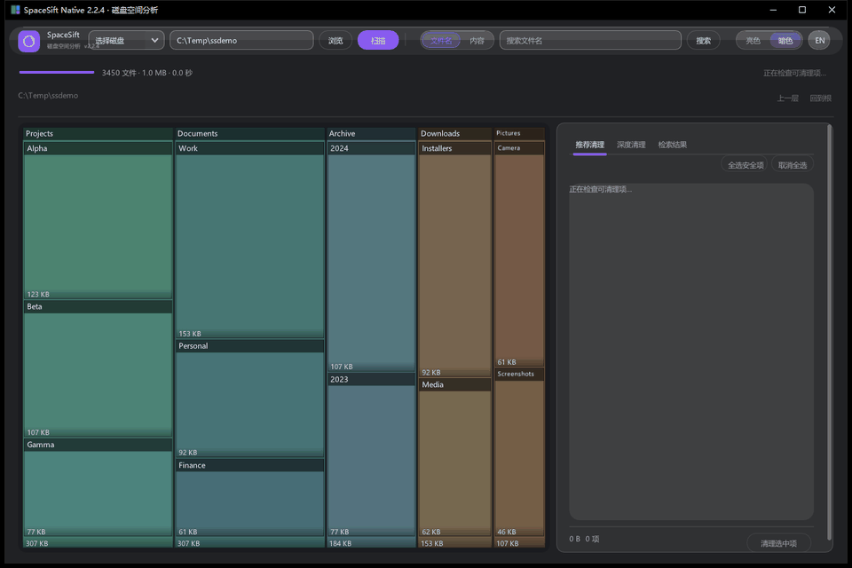
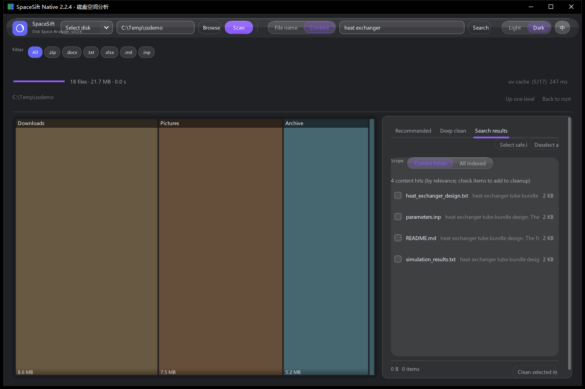
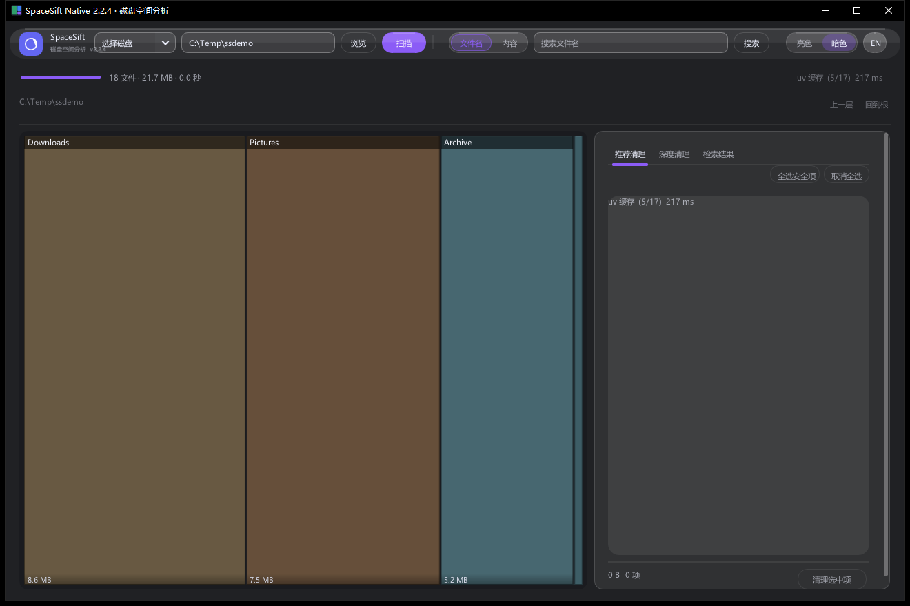
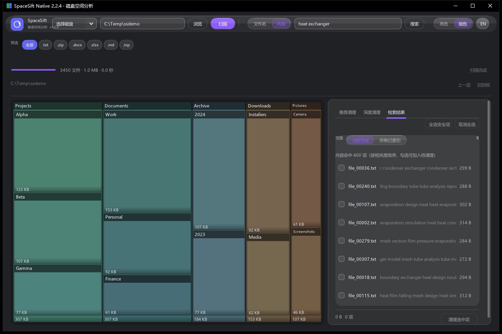
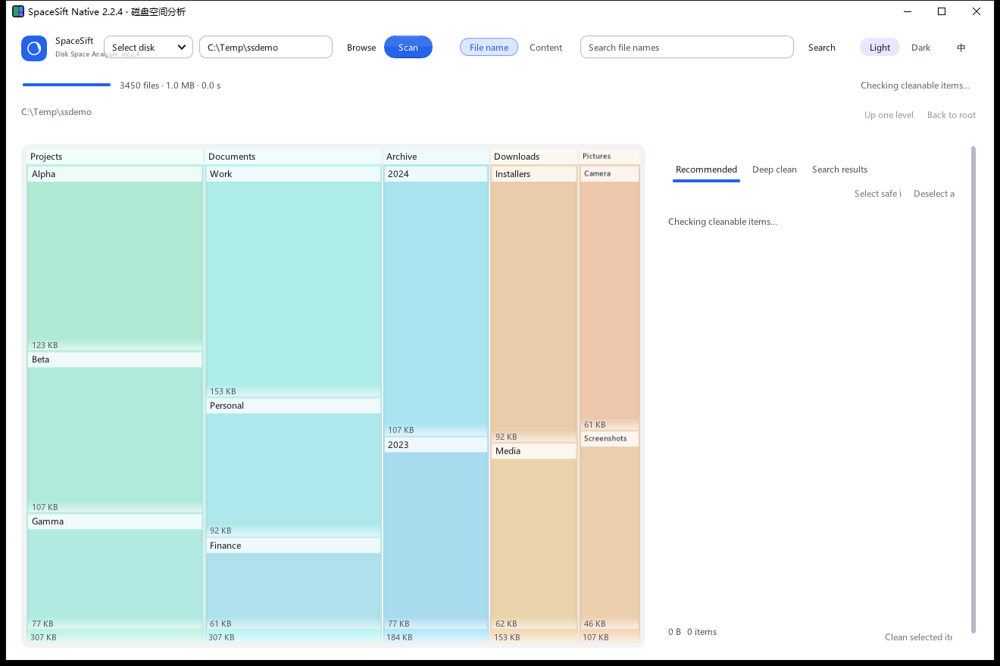

# SpaceSift Native

Disk space analyzer + **full-text content search**. Native C++ + ImGui, single executable, no runtime to install.

[简体中文](README.md) | **English**

Current version: **2.3.0** (shown in the title bar).



| English UI | 中文界面 |
|---|---|
|  |  |

| Filename search | Content search (with snippets) |
|---|---|
|  |  |

The UI supports **one-click Chinese/English switching** (the `EN / 中` pill in the top bar; takes effect instantly and the choice is remembered). Light theme:



## Download

Grab `SpaceSift-2.3.0-portable.zip` (recommended, includes the optional PDF/DWG/OCR dependencies) or `SpaceSift-2.3.0-exe-only.zip` from the [Releases](https://github.com/Twofruitsgrape/spacesift-native/releases) page. Unzip and double-click `SpaceSift.exe` — or run `install.bat` for a per-user install with a desktop shortcut. Verify checksums against `SHA256SUMS.txt`.

## Features

- **Treemap** — areas proportional to real disk usage; click a tile to drill down layer by layer; tiles grow live while scanning
- **Recommended cleanup** — 17 rules scan system and application caches, tick what you want and clean
- **Deep cleaning** — lists every child item of the current directory, tick to add to the cleanup queue
- **Search** — two modes sharing one **scope** switch (current folder / all indexed folders):
  - **Filename**: indexed during the scan, ~0.4 s over 3.38 M entries
  - **Content**: full-text search with hit snippets (PDF, Office, CAD, 3D, archives, OCR)
- **Index manager** — see how much each index costs, how many documents it holds, delete it
- **Confirmation** — every deletion first opens a dialog listing exactly what will go; nothing is deleted until you confirm, and it does not go to the Recycle Bin
- **Safety** — only paths inside the scanned range are touched; hits outside it are shown with a lock and cannot be ticked; protected system directories are always skipped
- **Chinese/English UI** — one click on the `EN / 中` pill in the top bar; light/dark theme toggle, right-click menu (Open containing folder / Copy path / Scan from here)

## Usage

1. Download `SpaceSift.exe` and double-click it (no installation)
2. Pick a drive or type a path, then click **Scan**
3. When the scan finishes:
   - Click tiles on the left to walk down the tree and see what is using the space
   - Tick the items you want to clean on the right
   - Click **Clean selected** and confirm in the dialog

> Cleanup rules target system and application cache directories. When you scan a non-system drive those items will not appear — that is expected.

## Benchmarks

Drive C, 3.39 M files / 436 GB: scan takes 38 s, peak memory 125 MB, executable 2.3 MB.

## Requirements

Windows 10 1803+ / Windows 11, 64-bit. Uses the DirectX 11 and UCRT components that ship with the OS; no extra runtime needed.

> Seeing "Microsoft Edge WebView2 Runtime is missing"? That message comes from the **legacy 1.x** build (Python + WebView2 UI). Since 2.x the whole app is one native statically-linked exe — no WebView2, no runtime install. Grab a 2.3.0 package instead of old releases.

## Building from source

Requires MinGW-w64 (`g++`, `gcc`, `windres` on `PATH`).

```bat
build.bat
```

Or manually:

```bash
# 1) Build SQLite (once)
gcc -O2 -c third_party/sqlite/sqlite-amalgamation-3450000/sqlite3.c -o build/sqlite3.o \
  -DSQLITE_OMIT_LOAD_EXTENSION -DSQLITE_THREADSAFE=1 -DSQLITE_DEFAULT_MEMSTATUS=0 \
  -DSQLITE_OMIT_DEPRECATED -DSQLITE_DQS=0 -DSQLITE_OMIT_EXPLAIN

# 2) Build resources and the app
windres src/app.rc -o build/app_res.o

g++ -O2 -std=c++17 -static -s -mwindows \
  -I third_party/imgui -I third_party/imgui/backends \
  -I third_party/sqlite/sqlite-amalgamation-3450000 -I src \
  src/main.cpp src/db.cpp src/rules.cpp build/sqlite3.o build/app_res.o \
  third_party/imgui/imgui.cpp third_party/imgui/imgui_draw.cpp \
  third_party/imgui/imgui_tables.cpp third_party/imgui/imgui_widgets.cpp \
  third_party/imgui/backends/imgui_impl_win32.cpp \
  third_party/imgui/backends/imgui_impl_dx11.cpp \
  -ld3d11 -ldxgi -ld3dcompiler -ldwmapi -lgdi32 -luser32 -lshell32 -lole32 -limm32 \
  -o build/SpaceSift.exe
```

## License

MIT
