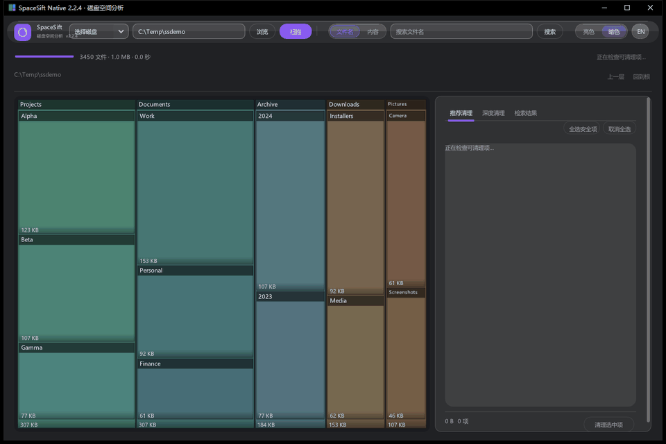
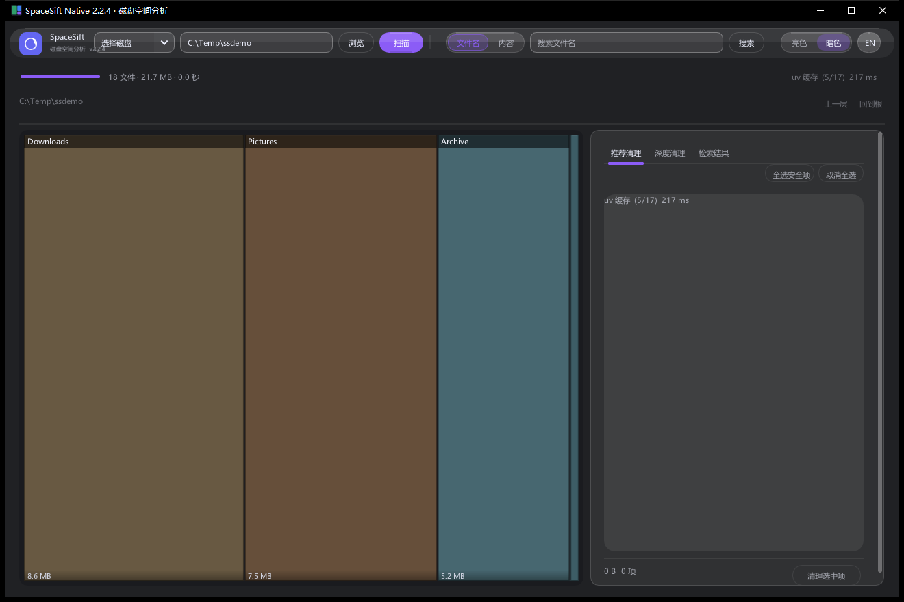
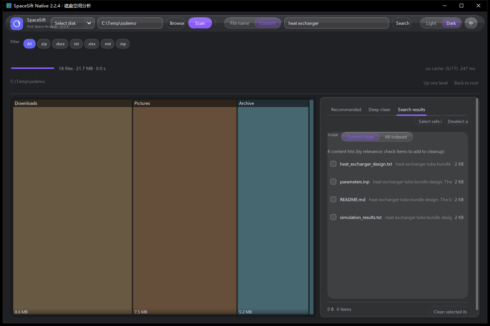
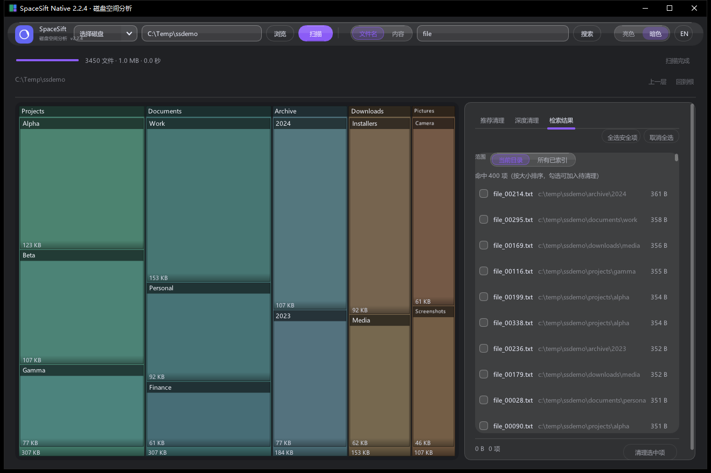
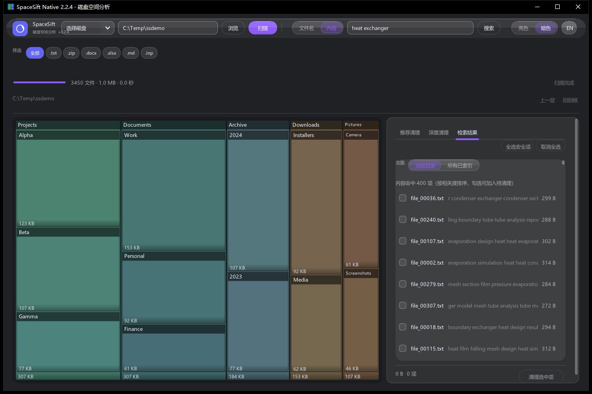
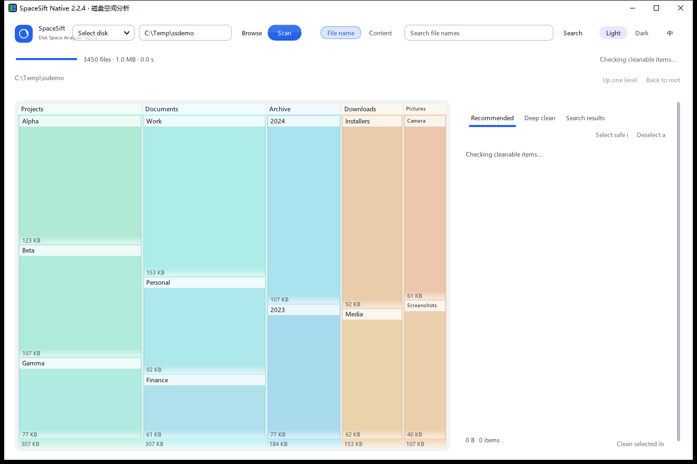

# SpaceSift Native

磁盘空间分析 + **文件内容检索**。原生 C++，单文件 exe，不装任何运行时。

**简体中文** | [English](README.en.md)

当前版本 **2.3.0**（标题栏可见）。



| 中文界面 | English UI |
|---|---|
|  |  |

| 文件名检索 | 内容检索（带命中片段） |
|---|---|
|  |  |

界面支持**中英文一键切换**（顶栏 `EN / 中` 按钮，即时生效并记住选择）；文档也提供[英文版](README.en.md)。

| 亮色主题 | 内容检索（English） |
|---|---|
|  |  |

## 下载

到 [Releases](https://github.com/Twofruitsgrape/spacesift-native/releases) 页面：

| 包 | 大小 | 说明 |
|---|---|---|
| **`SpaceSift-2.3.0-portable.zip`** | 22 MB | **推荐**。解压后双击 `SpaceSift.exe`，或运行 `install.bat` 一键安装（装到当前用户目录 + 建桌面快捷方式，不需要管理员） |
| `SpaceSift-2.3.0-exe-only.zip` | 2.0 MB | 只要主程序。文本/代码/Office/压缩包/三维模型可用；**PDF、DWG、OCR 需要额外的 dll**（见 `USAGE.md`） |

两种都不写注册表，删除目录即卸载。

### 下载后先跑一次自检

解压 → 双击 **`selftest.bat`**。它会自己在临时目录造 12 个样本文件（txt/GBK/DXF/STEP/OBJ/
docx/xlsx/pptx/zip 内层/PDF/ABAQUS/旧版 doc），逐格式抽正文、建索引、搜关键词、验增量和
跨目录检索，**跑完把自己造的东西全删掉**，不碰你的文件。

```
通过 34 · 失败 0 · 跳过 0      ← 这个包可以正常使用
```

缺 `pdfium.dll` 时 PDF 那条会标 `[SKIP]` 而不是假装通过。想顺便体检自己的目录：

```bat
selftest.bat "D:\某个目录"
```

打包脚本 `pack_release.py` 在出包前还会做一道**出厂审计**：文件集合必须和白名单完全一致，
且任何文件里出现本机用户名、`C:\Users\xxx`、索引库文件名就拒绝出包。

### 下载后提示「你的 Internet 安全设置阻止打开一个或多个文件」？

这是 Windows 给**所有网络下载文件**打的 Mark-of-the-Web 标记，不是病毒警告，点「确定」即可。
不想每次看到就先解除锁定：

```
右键 zip → 属性 → 勾选「解除锁定 / Unblock」→ 应用 → 再解压
```

首次运行 exe 若弹「Windows 已保护你的电脑」（SmartScreen）：因为程序**没有代码签名证书**，
点「更多信息 → 仍要运行」即可。校验文件完整性：

```powershell
Get-FileHash .\SpaceSift-2.0.5-portable.zip -Algorithm SHA256
# 对比发行页 SHA256SUMS.txt 里的值
```

### 弹「这台电脑缺少 Microsoft Edge WebView2 运行时」？

那是 **1.x 旧版**的提示 —— 旧版界面用 Python + WebView2 做的，没有运行时确实开不了。
**2.x 起整个程序就是一个原生 exe（静态链接），不再需要 WebView2，也不安装任何运行时**；
只要 Windows 10 1803+ / Windows 11，64 位。

如果你的安装包一启动就弹这个窗，说明下到旧版了：回 Releases 页面下 2.2.1，
别装旧包，也别为它去装 WebView2。

## 功能

- **方块图** — 按真实占用面积展示，点方块逐层下钻；扫描过程中方块实时生长
- **推荐清理** — 17 条规则检查系统与应用缓存，勾选后清理
- **深度清理** — 列出当前目录的全部子项，可勾选加入待清理
- **检索结果** — 两种模式，共用一个**范围**开关（当前目录 / 所有已索引）：
  - **文件名**：扫描时同步建索引，338 万条约 0.4 秒出结果
  - **内容**：搜文件正文，带命中片段，可勾选进批量清理
- **索引可管理** — 右栏「索引管理」列出每份索引的体积、文档数、建立时间，可单独删除
- **二次确认** — 任何删除都先弹窗列出清单，确认后才执行，不进回收站
- **安全边界** — 只处理扫描范围内的路径；范围外的检索结果会带锁标出、不可勾选，系统受保护目录一律跳过
- **中英文界面** — 顶栏一键切换，跟随保存；明暗主题切换、右键菜单（打开所在位置 / 复制路径 / 从此处扫描）

### 检索范围：换个文件夹就搜不到？

2.2.0 之前每个扫描目录各建一份索引，**搜索只查当前目录那一份** —— 换个文件夹，之前建好的索引就
"人间蒸发"，看着像功能是假的。现在两种模式都带范围开关：

| 范围 | 行为 |
|---|---|
| **当前目录**（默认） | 只查当前扫描根对应的索引，和以前一致 |
| **所有已索引** | 把每份索引都查一遍，按路径去重合并；同一文件被父/子目录各索引过也只出现一条 |

跨目录搜到的结果如果不在当前扫描范围内，行首是**锁**而不是勾选框，并标 `范围外` —— 防止
"在 A 目录里搜到 B 目录的文件，一勾一删把 B 的文件删了"。想清理它，扫它所在的目录即可。

没建索引就搜内容，不会再静默返回 0 条，而是直接告诉你是哪个目录缺索引，并给「建立内容索引」按钮。

切范围、改关键词都不会再卡界面：检索在后台线程跑，右栏显示「正在搜索…」，方块图和顶栏照常响应。
（27 份索引的跨库查询实测 5.5 秒，以前这段时间界面是定住的。）

## 扫描会伤硬盘吗？

不会。可以从机制上核对：

| 动作 | 对磁盘做了什么 | 有没有写入 |
|---|---|---|
| 扫描（方块图/文件名索引） | `FindFirstFileExW(..., FindExInfoBasic)` 只读目录项（NTFS 的 MFT 元数据），**不打开文件、不读正文** | 被扫的盘 **0 写入** |
| 建立内容索引 | 只读打开文件抽文字，写的是 `%LOCALAPPDATA%\SpaceSiftNative` 里的 SQLite 库 | 只写系统盘上的索引文件 |
| 清理 | 按你勾选并二次确认的清单直接删除 | 唯一的破坏性操作 |

几个常被担心的点：

- **SSD 寿命**：读操作不消耗写入寿命（TBW），全盘扫一遍也不写一个字节。
- **最后访问时间**：NTFS 从 Vista 起默认关闭 last-access 更新，枚举目录也不会触发。
- **云盘占位文件**：OneDrive 之类的占位文件带 `FILE_ATTRIBUTE_REPARSE_POINT`，直接跳过，
  不会顺手把云端文件下载下来。
- **机械盘**：全盘枚举有轻微寻道声，属于正常读取，不是磨损。

真正会毁数据的只有「清理」：它**不进回收站**，所以任何删除都先弹窗列清单、要你确认。

## 「打开所在位置」点下去没反应？

这一版把这条链做成了**逐级验证**，不再相信 `SHOpenFolderAndSelectItems` 返回的 `S_OK`
（Windows 上确实会出现「返回成功但窗口没出来」，本项目实测复现过）：

| 级别 | 做法 | 需要和 explorer 握手 |
|---|---|---|
| 1 | `SHOpenFolderAndSelectItems` | 是 |
| 2 | `ShellExecuteW("open")` / `("explore")` | 是 |
| 3 | `CreateProcessW(explorer.exe "目录")` | 否 |
| 4 | 用 explorer 的令牌降权起 explorer（管理员模式下唯一能过 UIPI 的路） | 否 |

每级成功后都会**把资源管理器窗口拉到前台**（`IShellWindows` 找到目录对应的窗口 →
`SetForegroundWindow`），所以即使窗口开在程序后面也能看见。

万一还是没打开，看日志（不设环境变量也会写）：

```
%LOCALAPPDATA%\SpaceSift\reveal.log
```

`%LOCALAPPDATA%` = `C:\Users\<你的用户名>\AppData\Local`。日志里每一行带 `shell=` `SE=`
`EX=` `activate ... ok=` 的错误码，最后一行就是卡在哪一级。


## 内容检索支持哪些格式

| 类别 | 格式 |
|---|---|
| 文本 / 代码 | 60+ 后缀（txt md csv log json xml yml ini html css + c/cpp/py/js/ts/rs/go/java…），自动识别 UTF-8 / GBK / UTF-16 |
| Office 新版 | docx docm xlsx xlsm pptx pptm odt ods odp |
| **Office 旧版** | **doc / xls / ppt**（原生解析 OLE2：FIB / BIFF8 SST / PPT 文本流 + UTF-16 兜底，**零依赖**） |
| PDF | 文本层；**扫描件自动 OCR**（含坏文本层抢救） |
| 图片 | png / jpg / bmp / tif（可选，需装 Tesseract） |
| 电子书 | **epub** |
| 邮件 | **eml**（MIME 解码）/ **msg** |
| 图纸 | **dxf** / **dwg** / 扫描图 |
| 三维 | **step / stp** / iges / igs / obj |
| SolidWorks | **sldprt / sldasm / slddrw**（自定义属性、配置名、装配体零件引用、焊接清单、图纸页） |
| COMSOL | **mph**（流式读，几百 MB 不占内存） |
| CAE 文本 | inp / cdb / anf / wbpj / dat / msg / sta / jnl / rpy（ABAQUS、ANSYS） |
| 压缩包 | **zip / rar / 7z**（条目名 + 内层文本文件） |

**读不了的**：`.cae` `.odb`（Abaqus）、`.db` `.rst`（ANSYS）——私有二进制，必须装对应软件。

## 检索语法

```
词A 词B              同时包含（默认 AND）
"完整短语"           短语匹配
词A OR 词B           任一包含
-词C                 排除
ext:pdf              只看某类扩展名（可写 ext:pdf,docx）
name:报告            文件名里包含
size:>10m            大于 10 MB（支持 k/m/g）
after:2024-06        修改时间在 2024-06 之后
re:正则  或 /正则/   正则匹配（全表扫描，慢）
```

界面里也可以直接点搜索框下面那排**后缀标签**筛选，点一下立刻重搜。

搜索框右边有 **「搜索」** 按钮（不用非得按回车），`Ctrl+F` 可以把光标跳到搜索框。

## 使用

1. 双击 `SpaceSift.exe`（或安装后的桌面快捷方式）
2. 顶栏 `EN / 中` 可切换界面语言（即时生效，下次启动沿用）
3. 选磁盘或输入路径，点「扫描」
3. 扫描完成后：
   - 左侧点方块，逐层查看空间被谁占了
   - 顶部搜索框切到「内容」，右栏点「建立内容索引」，然后搜关键词
   - 右侧勾选要清理的项目，点「清理选中项」，在弹窗里确认

> 推荐清理的规则针对系统/应用缓存目录。扫描非系统盘时这些项目不会出现，属正常。

### 外部依赖（全部可选，缺了只是少一类格式）

| 格式 | 需要 | 体积 |
|---|---|---|
| PDF | `pdfium.dll`（便携包里已带） | 7.8 MB |
| DWG | `dwg2dxf.exe` + `libredwg-0.dll`（便携包里已带，GPLv3） | 32 MB |
| 扫描件/图片 OCR | Tesseract-OCR + `tessdata/`（便携包里已带语言包） | 17 MB |
| rar / 7z | WinRAR 或 7-Zip（从注册表/Program Files 自动找） | — |
| 旧版 Office（增强） | 不需要（原生解析）；复杂文件可选装 catdoc / LibreOffice | — |

## 实测

| 语料 | 文件 | 体积 | 首次建索引 | 正文字符 | 索引库 |
|---|---:|---:|---:|---:|---:|
| 个人资料 | 3,274 | 46 GB | 42 秒 | 3,372 万 | 64 MB |
| 代码仓库 | 16,624 | 135 GB | 251 秒 | 7,819 万 | 117 MB |

之后都是**增量**（文件没变就跳过，实测 0.06 秒）。查询 2–120 ms。

C 盘 339 万文件 / 436 GB：扫描 38 秒，内存峰值 125 MB，exe 4 MB。

### 2.2.0 的索引体积

| 语料 | 文档 | 2.1.x 索引库 | 2.2.0 索引库 |
|---|---:|---:|---:|
| 代码仓库目录（9,324 篇） | 9,324 | 116.6 MB | **78.3 MB** |

做法是**正文只存前 16 KB（做命中片段），倒排仍吃满 64 KB** —— 体积降三分之一，
但"文档第 50 页出现的关键词"照样搜得到（召回不掉）。空出来的空间主要来自 `docs.text`
这一列，它原来按 64 KB/文件 存。

> 升级到 2.2.0 后第一次建索引会**整库重建一次**（右栏有提示），因为抽取参数变了。
> 旧库名（路径截断 40 字符）会自动改成带哈希的新名字，不用手动清理。

## 运行环境

Windows 10 1803+ / Windows 11，64 位。依赖系统自带的 DirectX 11 与 UCRT，无需额外安装运行时。

## 从源码构建

需要 MinGW-w64（`g++`、`gcc`、`windres`）。没有的话三种任选一种：

```bat
setx W64DEVKIT_DIR "C:\path\to\w64devkit"      :: 方式一：环境变量
:: 方式二：在 build.bat 同目录建 toolchain.txt，写工具链根目录（一行）
:: 方式三：把 MinGW 的 bin 直接加进 PATH
```

```bat
build.bat
```

## 许可

主程序 **MIT**。第三方组件的许可见 [`packaging/THIRD-PARTY-NOTICES.md`](packaging/THIRD-PARTY-NOTICES.md)。

> LibreDWG（`dwg2dxf.exe` / `libredwg-0.dll`）是 **GPL-3.0**，但它是**独立进程**被调用的，
> 主程序不链接任何 GPL 代码，所以主程序可以保持 MIT。删掉这几个文件即可完全避开 GPL，
> DWG 格式不再参与检索，其余功能不受影响。
